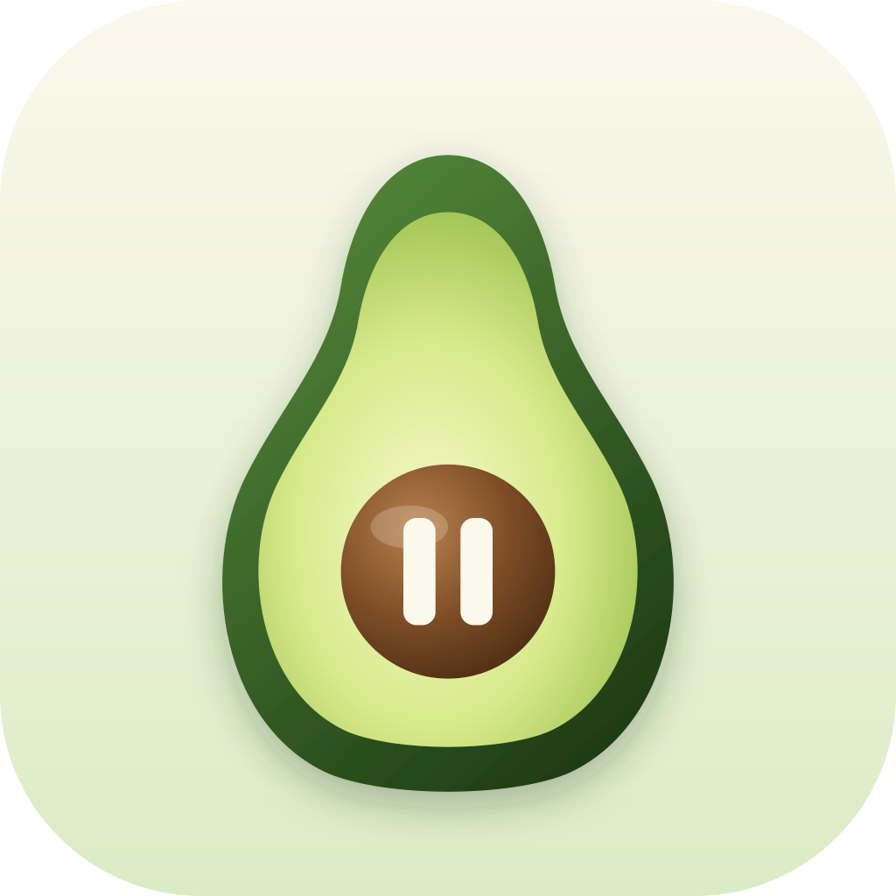
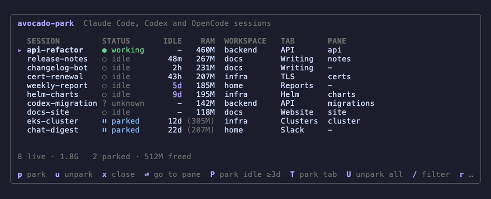
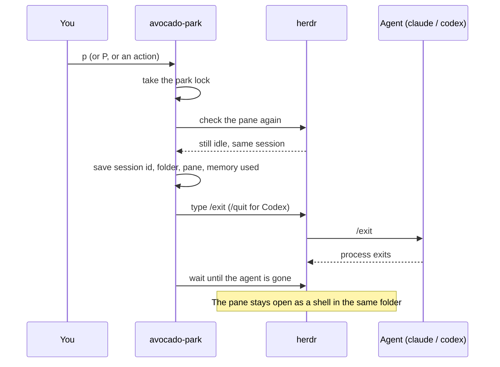
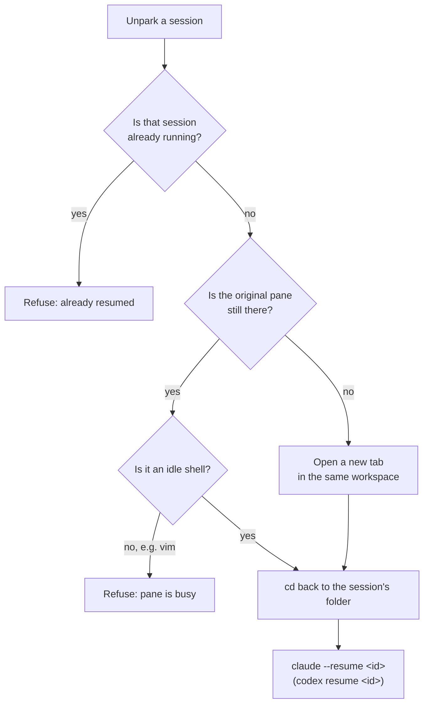

<p align="center"></p>

<h1 align="center">avocado-park</h1>

<p align="center">
  <a href="https://github.com/andymartinezot/avocado-park/releases/latest"></a>
  <a href="https://github.com/andymartinezot/avocado-park"></a>
</p>

**Park idle Claude Code, Codex and OpenCode sessions to free memory, without closing their [herdr](https://herdr.dev) panes.**
Resume them later in the same pane, with the full conversation. No session ids to copy, and no
guessing which pane held which work.

| | |
|---|---|
| **What it frees** | 150–500 MB per Claude Code session: the agent, its MCP servers and the shells it spawned |
| **Park** | Exits the agent (`/exit`, or `/quit` for Codex). The pane stays as a plain shell in the same folder |
| **Agents** | Claude Code, Codex and OpenCode |
| **Unpark** | Runs `claude --resume <id>` (`codex resume <id>`, `opencode --session <id>`) in that same pane |
| **Where** | A herdr popup panel, herdr actions with toasts, a CLI, and a skill for your agent |
| **Runs on** | macOS and Linux, herdr 0.9.3+ |

---

## Contents

- [Why](#why)
- [Demo](#demo)
- [Quick start](#quick-start)
- [The panel](#the-panel)
- [How it works](#how-it-works)
- [herdr actions](#herdr-actions)
- [CLI reference](#cli-reference)
- [Codex and OpenCode](#codex-and-opencode)
- [Agent skill](#agent-skill)
- [Configure](#configure)
- [Safety](#safety)
- [State and privacy](#state-and-privacy)
- [Troubleshooting](#troubleshooting)
- [Develop](#develop)

---

## Why

An open Claude Code session keeps a Node process running, along with every MCP server and shell it
started. That memory stays in use even when you haven't touched the session in a week. With ten
agent panes open, it adds up to a few GB.

Closing idle panes frees it, but then you have to remember which folder, which workspace and which
session id each one had. So most people leave everything running.

avocado-park adds a third option:

```text
park   = exit the agent, keep the pane, remember the session
unpark = resume that session in the same pane
```

---

## Demo



In the recording:

1. `/` filters the list by workspace.
2. `P` parks every session idle for 3 days or more. Each one's RAM cell shows the memory it freed,
   in brackets, and the footer adds up the total.
3. `T` parks every idle session in the selected session's tab.
4. `u` resumes a parked session in its pane, with the full conversation.

The sessions are made up (`scripts/demo`), so the recording never touches real ones. Outside the
panel, focusing a parked pane shows a toast naming the session, so the plain shell there isn't
mistaken for a finished one.

---

## Quick start

```sh
herdr plugin install andymartinezot/avocado-park
herdr integration install claude     # so herdr knows each pane's session id
herdr integration install codex      # optional, for Codex
herdr integration install opencode   # optional, for OpenCode
```

The install downloads a checksum-verified binary for macOS or Linux (arm64 or amd64). If
[Go](https://go.dev/dl) 1.24 or newer is installed, it builds from source instead.

> **What you're trusting:** release binaries are built by GitHub Actions from this repository
> (actions pinned to commit SHAs). The install downloads over HTTPS and checks the sha256 published
> with the release, which catches corrupted downloads; the trust root is GitHub and this repository.
> If anything doesn't verify, it builds from source instead of installing the binary. Prefer to
> check first? Read [`scripts/fetch-or-build.sh`](scripts/fetch-or-build.sh).

Then open herdr's action list and pick **Park: show sessions**. To open it with a key instead, add
this to `~/.config/herdr/config.toml`, using a key that is free in your setup:

```toml
[[keys.command]]
key = "prefix+shift+p"
type = "plugin_action"
command = "andymartinezot.avocado-park.open-panel"
description = "avocado-park: sessions"
```

herdr reads `config.toml` only when it starts, so run `herdr server reload-config` after adding
the key. Until you do, the key does nothing.

---

## The panel

```
╭───────────────────────────────────────────────────────────────────────────────╮
│ avocado-park  Claude Code, Codex and OpenCode sessions                        │
│                                                                               │
│   SESSION        STATUS       IDLE    RAM  WORKSPACE   TAB       PANE         │
│ ▸ api-refactor   ● working       -   460M  backend     API       api          │
│ • release-notes  ○ idle        48m   267M  docs        Writing   notes        │
│   cert-renewal   ○ idle        43h   207M  infra       TLS       certs        │
│   weekly-report  ○ idle         5d   185M  home        Reports   -            │
│   helm-charts    ○ idle         9d   195M  infra       Helm      charts       │
│   k8s-cluster    ⏸ parked      12d (305M)  infra       Clusters  cluster      │
│   chat-digest    ⏸ parked      22d (207M)  home        Slack     -            │
│                                                                               │
│ 5 live · 1.3G   2 parked · 512M freed                                         │
│                                                                               │
│ p park  u unpark  x close  ⏎ go to pane  P park idle ≥3d  T park tab  …       │
╰───────────────────────────────────────────────────────────────────────────────╯
```

`TAB` and `PANE` show the names you gave them in herdr, with `-` for a pane without a name. A parked
session keeps showing them after its pane is closed. In a narrow window, `PANE` is dropped first and
then `TAB`.

| Key | Action |
|---|---|
| `p` | Park the selected session |
| `u` | Resume the selected parked session |
| `x` | Close the selected session: exit the agent, close its pane, remove it from the list (asks first) |
| `⏎` | Jump to the session's pane |
| `P` | Park every session idle for 3+ days (asks first) |
| `T` | Park every idle session in the selected session's tab (asks first) |
| `U` | Resume every parked session (asks first) |
| `F` | Force-park the selected session even if herdr doesn't report it idle (asks first) |
| `/` | Filter by session, workspace, tab or pane name |
| `r` / `q` | Refresh / quit |

- An idle time in **purple** marks a session idle for 3 days or more. Those are the ones `P` parks.
- `•` marks the pane you opened the panel from. You can't park or close it from the panel, so you
  won't exit the session you're typing in.
- `parked*` marks a parked session whose pane is gone: it was closed, or now runs another agent.
  `u` resumes it in a new tab, and `x` removes it from the list. The footer repeats this whenever
  such a session is listed.
- The panel fills the popup and refreshes every 3 seconds, or every second while an action runs, so
  a batch shows each session parking as it happens. The cursor stays on the same session when rows
  move.

### Closing a session

Parking keeps a session for later. Closing is for one you're done with: `x` exits the agent, closes
the pane and removes the session from the list. The panel asks first, and nothing is kept to resume
it from here. The agent's own conversation history stays on disk, so `claude --resume <id>` still
finds it.

| The session is | `x` does |
|---|---|
| Live and idle, or `unknown` | Exits the agent, then closes the pane |
| Parked | Closes the pane, which is at a shell prompt |
| `parked*` | Removes it from the list; there's no pane to close |
| Working or waiting on you | Refuses. Let it finish, or answer it first |

Closing a tab's last pane closes the tab too. A pane another plugin added, such as a sidebar, stays
open, and so does its tab.

---

## How it works

### Parking



Only sessions that herdr reports as idle or done are parked. A session that is working, or waiting
for your answer, is refused unless you force it. Right before sending `/exit`, avocado-park checks the
pane again. If you used the session in the meantime, it is skipped.

### Unparking



Claude Code looks up conversations by folder, so avocado-park changes back to the session's folder
before resuming. It starts the agent through `herdr agent start`, so herdr tracks it again right away.

### Where the data comes from

- **Sessions:** herdr's agent list. Names, last activity and session ids come from Claude Code's
  `~/.claude/sessions/<pid>.json` when available.
- **Memory:** the agent's process plus everything it spawned (MCP servers, shells).
- **Parked sessions:** a small JSON file (see [State and privacy](#state-and-privacy)). If you resume
  a parked session by hand, it drops off the list on its own.

---

## herdr actions

Every action is in herdr's action list. The headless ones report the result in a toast.

| Action | What it does |
|---|---|
| **Park: show sessions** | Opens the panel |
| **Park: this session** | Parks the session in the focused pane |
| **Park: resume this session** | Resumes the focused pane's parked session |
| **Park: this tab** | Parks every idle session in the focused tab. Busy ones keep running, and the toast names them |
| **Park: resume this tab** | Resumes every parked session of the focused tab |
| **Park: all idle sessions** | Parks every session idle for 3+ days, except the focused one |
| **Park: resume all parked sessions** | Resumes every parked session |

When you focus a pane that holds a parked session, a toast names it and says how to resume it.

---

## CLI reference

The same binary works from any terminal while herdr is running:

```sh
avocado-park list [--json]              # live and parked sessions
avocado-park park [--force] [TARGET]    # park one session
avocado-park park --tab [TARGET]        # park every idle session in a tab
avocado-park park --idle [--days N]     # park every session idle N+ days (default 3)
avocado-park unpark [TARGET]            # resume one parked session
avocado-park unpark --tab [TARGET]      # resume a tab's parked sessions
avocado-park unpark --all               # resume every parked session
avocado-park close TARGET               # exit the agent, close its pane, forget the session
avocado-park panel                      # the interactive panel
avocado-park version
```

`TARGET` is a pane id (`w3:p14`), a session name, or a session id (8+ characters). Inside herdr it
defaults to the focused pane, except for `close`, which always needs one and refuses the pane it
runs in. `list --json` is meant for scripts and other tools.

Add `--dry-run` to any `park`, `unpark` or `close` command to see what it would do, without changing
anything:

```console
$ avocado-park park --tab release-notes --dry-run
would park release-notes (claude, idle, idle 48m, in pane w2:p3)
would park changelog-bot (claude, idle, idle 2h, in pane w2:p4)
```

Run from a terminal inside herdr, `park --tab` never parks the pane it runs in.

---

## Codex and OpenCode

Codex sessions appear next to Claude Code ones. They park with `/quit` and resume with
`codex resume <id>`.

herdr can't always tell when a Codex turn has ended, so it often reports Codex as `unknown` instead
of idle. avocado-park doesn't park those on its own. Once you know a Codex session is done, park it with
`F` in the panel or `avocado-park park --force <name>`.

Codex keeps part of its memory in a shared background process, so parking a Codex session frees less
than parking a Claude Code one.

OpenCode sessions park with `/exit` and resume with `opencode --session <id>`. They need herdr's
OpenCode integration (`herdr integration install opencode`) so herdr knows their session ids.

Idle times come from Claude Code's session files, so Codex and OpenCode sessions show no idle time
and `P` doesn't pick them up. Park them with `p`, `T` or the CLI.

---

## Agent skill

[`skills/avocado-park/SKILL.md`](skills/avocado-park/SKILL.md) teaches your coding agent to use the CLI,
so you can ask it to "park my idle sessions" or "resume the infra tab". It dry-runs first, never
parks its own session, and never forces a park without asking you.

```sh
mkdir -p ~/.claude/skills && cp -R skills/avocado-park ~/.claude/skills/    # Claude Code
```

Other agents that read `SKILL.md` folders (Codex, OpenCode) use the same folder in their own skills
directory.
---

## Configure

`~/.config/herdr/plugins/config/andymartinezot.avocado-park/config.toml`. Every setting is optional:

```toml
park_idle_days = 3     # threshold for P, the purple marker and park --idle
auto_park_days = 0     # park sessions idle this many days on their own; 0 = off
refresh_seconds = 3    # panel refresh interval
claude_dir = "~/.claude"
```

**Auto-park:** herdr has no timers, so auto-park runs when you switch panes, at most once an hour. It
never parks the pane you just focused, and nothing runs while you aren't using herdr. A toast lists
what was parked.

---

## Safety

Parking stops a process, so avocado-park is careful about what it parks and where it types.

- **Refuses busy sessions:** a session that is working or waiting on you is only parked with
  `F` / `--force`, and the panel asks first.
- **Checks again before acting:** each park and unpark re-reads the pane right before it types
  anything, so a session you started using again in the meantime is left alone.
- **One action at a time:** a lock file stops two parks or unparks (say, the panel and auto-park)
  from touching the same session at once.
- **Never resumes twice:** if a parked session is already running somewhere, unpark refuses.
- **Only types into a shell:** unpark won't type into a pane running another program, such as vim.
  If the pane is gone, it opens a new tab.
- **Only closes a shell:** close leaves a pane open if it runs another program, now holds another
  agent, or moved to another workspace. If the agent doesn't exit, the pane stays open too.
- **Validates what it types:** session ids must be plain ids, and folders containing control
  characters are refused, so nothing unexpected reaches the shell. It only types `cd` into POSIX
  shells (sh, bash, zsh, dash, ksh); in fish, nu or csh it opens a new tab in the folder instead.
- **Cleans what it shows:** session names come from terminal titles, which any program can set, so
  control characters are stripped before they reach your terminal.

---

## State and privacy

Parked sessions live in `~/.local/state/avocado-park/parked.json` (or `$XDG_STATE_HOME/avocado-park`),
created readable only by you (`0600` file, `0700` folder). It holds session names, folders, pane ids
and session ids. Don't commit or share it.

avocado-park makes no network calls. It only talks to herdr's local socket.

---

## Troubleshooting

| Symptom | Fix |
|---|---|
| A session is missing from the panel | Install the herdr integration (`herdr integration install claude`), then restart that agent so herdr learns its session id |
| "is not idle" when parking | herdr reports it working or waiting. Wait for it, or use `F` / `--force` if you know it's done |
| A Codex session shows `unknown` | Expected, see [Codex and OpenCode](#codex-and-opencode). Use `F` |
| Listed as parked (pending) | The agent didn't exit within 20 s. Check the pane, then park it again |
| "pane … is running vim" on unpark | Quit that program so the pane is back at the shell prompt, then unpark again |
| Unpark opened a new tab | The original pane was closed (or, after a herdr restart, its id now belongs to another workspace) |
| A tab stays open after closing its session | Another plugin's pane, such as a sidebar, is still in it. Close the tab in herdr |

---

## Develop

```sh
git config core.hooksPath .githooks      # once per clone: run QA before every push
scripts/qa.sh                            # run QA by hand
go test -race ./...
go build -o bin/avocado-park ./cmd/avocado-park
herdr plugin link "$PWD"                 # link does not run the build step; run it again after adding event hooks
bin/avocado-park panel --print --width 84  # render one frame without a popup
go run ./scripts/demo                    # the panel with made-up sessions, no herdr needed
vhs scripts/demo/demo.tape               # re-record docs/avocado-park-demo.gif (brew install vhs)
```

`scripts/qa.sh` is what must pass before code reaches `main`. The `pre-push` hook runs it on the
commits being pushed, not on the working folder, and stops the push if anything fails:

| Step | Checks |
|---|---|
| Format, `go.mod`, vet | The code is formatted, dependencies are tidy, vet is clean |
| Unit tests | Everything, with the race detector, including a `parked.json` from an older release |
| End to end | A real herdr: the plugin loads, then park, resume and close a stand-in agent, using real keys in the panel. Existing config and parked sessions must survive |
| Real config untouched | Your `config.toml` files and `parked.json` are the same as before QA started |

The end-to-end step needs herdr installed but never uses the herdr you work in: it starts a private
server with its own home directory and socket.

Releases are cut by pushing a `vX.Y.Z` tag that matches `version` in `herdr-plugin.toml`. GoReleaser
then publishes the binaries and `SHA256SUMS`.

## License

MIT
